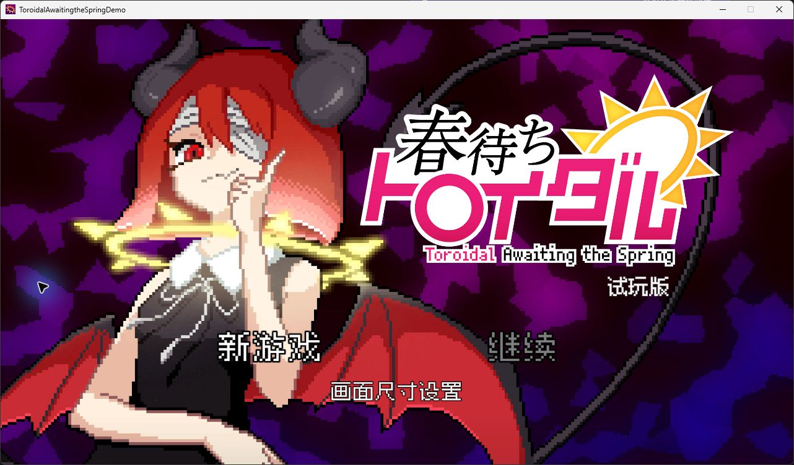
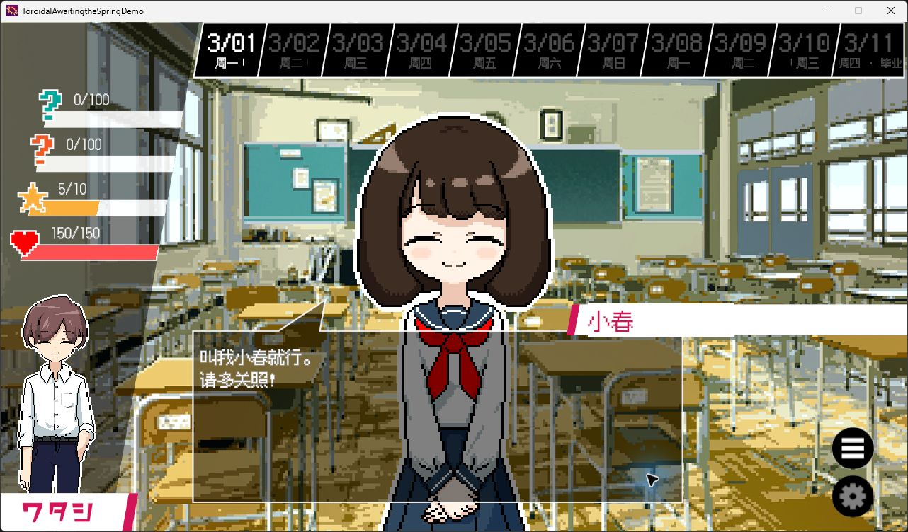
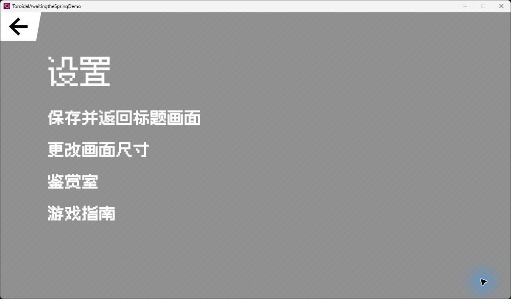
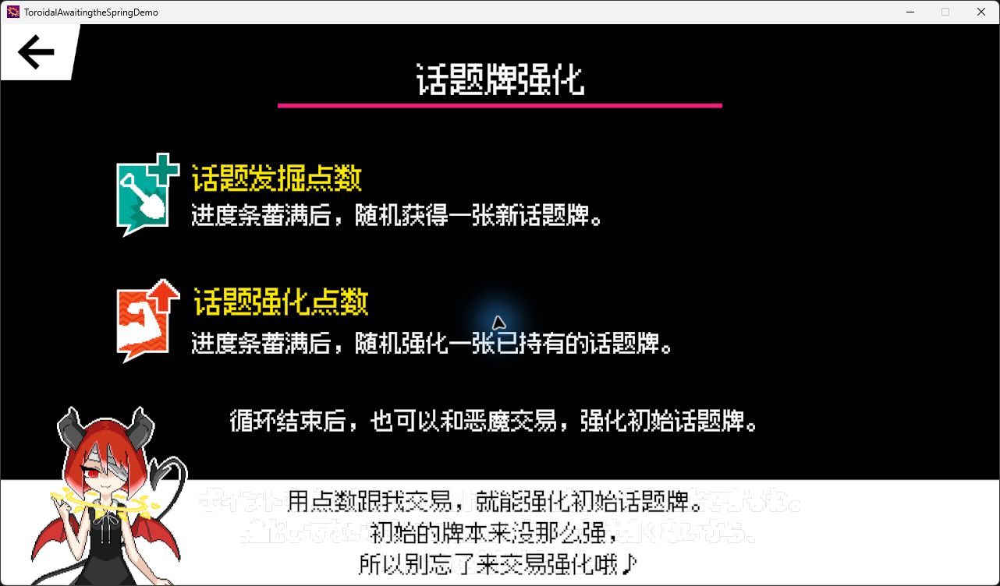

# 《春待ちトロイダル》Demo 简体中文补丁

这是为《春待ちトロイダル》Steam Windows 64 位试玩版制作的非官方个人汉化补丁。当前版本为 **0.3.4 预发布版**。游戏可以用简体中文试玩，部分台词、分支和界面细节仍待校对。

## 汉化实机预览

以下为 v0.3.4 的游戏内截图，展示菜单、剧情对白与游戏指南的中文显示效果。点击图片可查看原尺寸。

| 标题菜单 | 校园对白 |
| --- | --- |
|  |  |
| 设置菜单 | 游戏指南 |
|  |  |

## 下载和安装

1. 从 [v0.3.4 发布页](https://github.com/Qiankunyi/toroidal-demo-zh-cn/releases/tag/v0.3.4) 的 **Assets** 下载 **Toroidal-Demo-zh-CN-0.3.4.zip**，完整解压。
2. 在 Steam 库中右击试玩版，选择「管理 → 浏览本地文件」，复制打开的目录地址。目录里应当有 `ToroidalAwaitingtheSpringDemo.exe`。
3. 退出游戏，双击解压目录中的 **Install.cmd**，粘贴刚才复制的地址并回车。安装器校验游戏版本，并从官方发布页下载 BepInEx 5.4.23.4 Windows x64 版。安装完成后，照常从 Steam 启动 Demo。

也可以在 PowerShell 中使用 `.\Install.ps1 -GameDirectory '试玩版目录'`。已下载 BepInEx 的玩家可以加上 `-LoaderZip 'BepInEx ZIP 路径'`。

### 存档、升级和卸载

首次运行时，插件会复制原有的两份存档数据库。汉化后的进度另存于游戏目录的 `BepInEx\plugins\ToroidalChinese\Save`。插件在运行时加载文字，安装器只新增文件。

- **从旧版汉化升级**时先退出游戏，然后把压缩包中 `patch` 下的文件复制到 `BepInEx\plugins\ToroidalChinese`。保留原有的 `Save` 文件夹。
- **卸载**时退出游戏。如果 BepInEx 是由本补丁安装的，移出本补丁新增的 `winhttp.dll`、`doorstop_config.ini` 和 `BepInEx` 目录即可。需要留存汉化进度时，先备份上面的 `Save` 文件夹。

## 汉化内容

- 标题菜单、行动选项、状态变化、结算统计、牌组和技能说明，以及九页游戏指南。
- Demo 剧情数据库中的对白、选项、教程和角色档案。试玩范围以游戏实际开放的流程为准。
- 对白保持场景字号，按对话框宽度折行并优先在句末分页。对话记录和菜单使用中文像素字体。
- 人名以游戏内档案为准。根据中文语境重构部分昵称，并在首次自我介绍时交代它和本名的联系。

部分剧情译文以本地机器译稿为底稿，经术语统一和关键场景抽查。遇到问题，可以在 [Issues](https://github.com/Qiankunyi/toroidal-demo-zh-cn/issues) 附上游戏场景、触发步骤和截图。含剧透的截图请折叠。

## 构建与文本

使用 Windows PowerShell，从本机安装的 Steam Demo 和解压的 BepInEx 5.4.23.4 读取编译依赖。仓库包含插件源码、安装脚本及中文文本。

    .\Build.ps1 -GameDirectory '试玩版目录' -LoaderDirectory 'BepInEx 解压目录'

输出为 `patch\ToroidalChinese.dll`。`patch/story.tsv` 和 `patch/menu.tsv` 每行依次为原句的 SHA-256 键、制表符、简中译文。键使用 UTF-8 字节计算，结果编码为 Base64。`convert_translation_table.py` 可以将本地的原文／译文 TSV 转成该格式。修改译文时，请保留 `#player_name` 等游戏变量，以及用 `\n` 表示的换行。游戏指南的文字和坐标在 `patch/guide.tsv`。

## 原作与依赖

原作由 さめさめサメーション 开发。插件通过 BepInEx 和 Harmony 加载，像素字体使用 Fusion Pixel 12px 简体中文比例字体，字体许可随附。

- [Steam 原作页面](https://store.steampowered.com/app/2348880/)
- [BepInEx 5.4.23.4](https://github.com/BepInEx/BepInEx/releases/tag/v5.4.23.4)
- [Fusion Pixel 像素字体](https://github.com/TakWolf/fusion-pixel-font)
